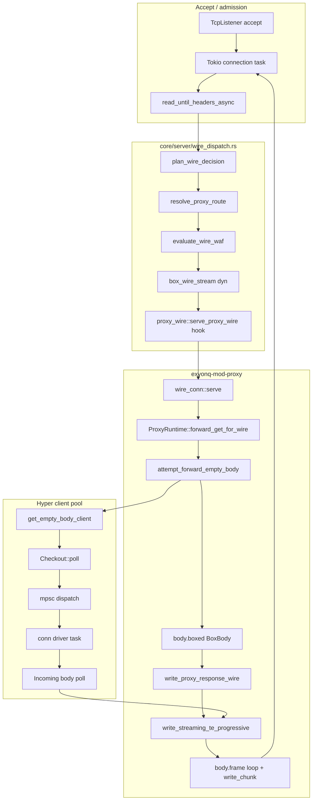
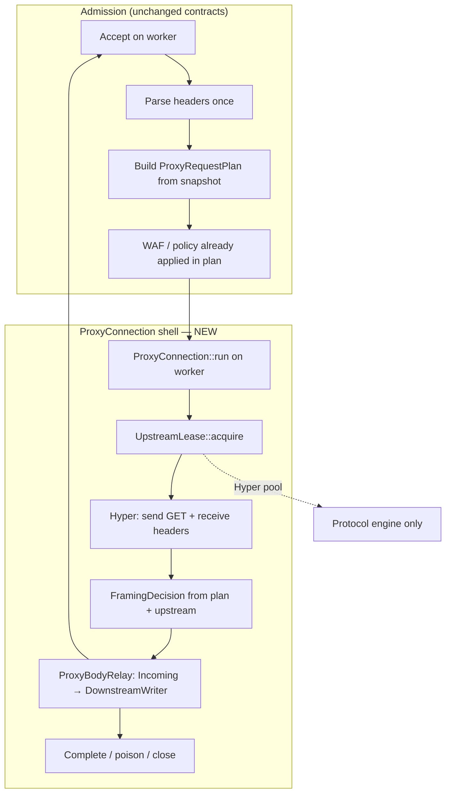
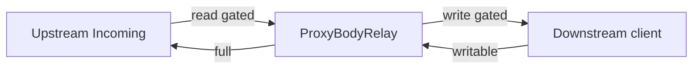
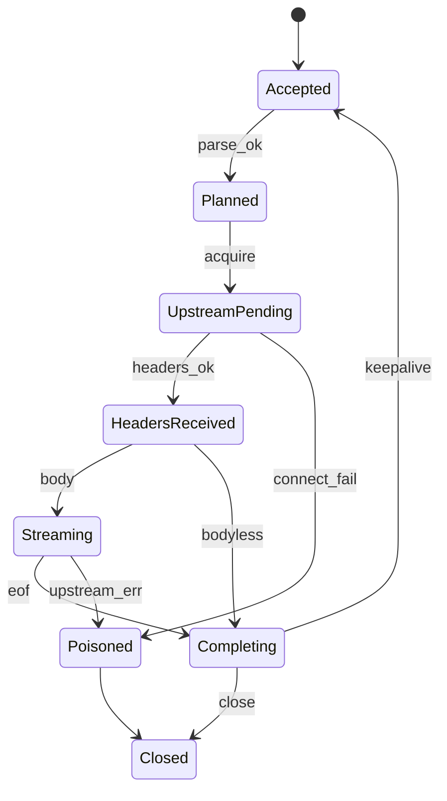
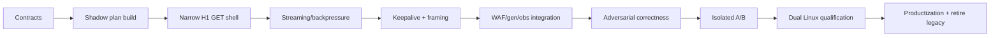

# V044 — Proxy execution data plane architecture design

```text
STATUS = COMPLETE
CASE = PXDP-B
WIP = V044_PROXY_EXECUTION_DATA_PLANE_ARCHITECTURE_DESIGN
MODE = READ_ONLY_DESIGN_AND_CONTRACT
PARENT_WIP = V044_DATA_PLANE_ARCHITECTURE_STRATEGIC_REVIEW
PARENT_CASE = DP-C
PRODUCT_MUTATION = NO
PROTOTYPE = NO
PUBLIC_BENCHMARK_CLAIMS = FORBIDDEN

SOURCE_HEAD = ade997a362e60d1dc6eafc984da454930600845a
SOURCE_TREE = 4ae6ffc7528d0881be23fcac246c345dcb9a1606
SOURCE_BINARY_SHA256 = e28c0abe18587f2d911d492be64cbec42372383e011417a6c578be52da5ba459
```

**Strategic note (post PR-C / GA-B / EP-C / SD-B):** PXDP design remains a **contracts/correctness** artifact. Performance material success = **NO** (PR-C). Further PXDP feature stacking / P6 / body-relay = **HOLD**. EP-C validated mio TPC geometry (+38.18% vs ExyonQ). SD-B defines specialized dataplane contracts (`ProxyExecutionPlan`); Hyper PXDP execution **RETIRE after SDP success**; PXDP tests **PRESERVE/ADAPT**. Next product WIP proposal (not authorized): SDP-P1. See [`v044-specialized-proxy-dataplane-contract-integration-design.md`](v044-specialized-proxy-dataplane-contract-integration-design.md).

**Canonical design document.** Governance summary: [`../governance/v044-proxy-execution-data-plane-architecture-design.md`](../governance/v044-proxy-execution-data-plane-architecture-design.md).

**Contracts & IR (PXDP-P0 — P0-A):** [`v044-proxy-execution-data-plane-contracts-ir.md`](v044-proxy-execution-data-plane-contracts-ir.md)

---

## 1. Strategic binding (DP-C)

| Verdict | Value |
|---------|-------|
| Architecture model | **MODEL_C_MIXED** |
| Static Cap067 | **PRESERVE** (P3 COMPETITIVE_WIN=YES) |
| Proxy execution | **STRUCTURALLY_OVER_LAYERED** |
| Primary strategy rejected | Option A (continue slice stacking) |
| Recommended direction | **Option C — dedicated proxy execution shell** |
| Full rewrite | **NO** |
| Rust | **KEEP** |
| Hyper | **TARGETED_REDUCTION** (not replacement) |
| Tokio | **TARGETED_REDUCTION** (not replacement) |

**Design question answered:**

```text
WHAT_PROXY_EXECUTION_MODEL_WOULD_REMOVE_MULTIPLE_ROOTS_BY_CONSTRUCTION =
  Worker-local ProxyConnection execution shell: one long-lived async task owns the
  client connection lifecycle, consumes a frozen RequestPlan snapshot, holds an
  UpstreamLease, and streams Hyper Incoming → downstream writer without BoxBody
  erasure, extra proxy serve tasks, or per-request stream re-boxing — while Hyper
  remains the upstream HTTP/1 protocol engine and Tokio remains the IO runtime.
```

---

## 2. Design objective

Minimize **by construction** (not by accumulating local fixes):

- Task boundaries, channel boundaries, thread handoffs
- Body type transitions, frame re-wrapping, dyn dispatch on hot path
- Allocations, Bytes refcount churn, payload copies
- Shared-state touches on body hot path

Preserve **one policy truth** (routing, WAF, generation, modules, observability) — the shell **executes** decisions; it does not reimplement them.

**Not in scope:** another P4-only fast path, Cap067 redesign, Hyper/Tokio replacement, custom HTTP stack.

---

## 3. Current proxy execution graph (source truth)

P4 nominal path: `GET /api/*` → Tokio accept (not Cap067 steady state) → wire dispatch → proxy wire → Hyper upstream → chunked client response.



### Stage ledger (current — P4 wire GET)

| # | Stage | File / symbol | Task? | Channel? | Buffer transition |
|---|-------|---------------|-------|----------|-------------------|
| 01 | TCP accept | `server` accept loop | Y | — | socket fd |
| 02 | Header read | `io::read_until_headers_async` | Y | — | Bytes head + rest |
| 03 | Framing safety | `request_headers_safe_for_wire` | Y | — | — |
| 04 | Wire plan | `plan_wire_decision` | Y | — | — |
| 05 | Route / cluster | `resolve_proxy_route` | Y | — | Arc snapshot read |
| 06 | WAF gate | `evaluate_wire_waf` | Y | — | — |
| 07 | Stream erase | `box_wire_stream` → `Box<dyn WireStream>` | Y | — | **dyn box** |
| 08 | Hook dispatch | `proxy_wire::serve_proxy_wire` → pinned future | Y | — | String XFF alloc |
| 09 | Generation check | `wire_conn::serve` cluster_generation | Y | — | RwLock-era runtime |
| 10 | Cluster resolve | `ProxyRuntime::upstream_for_cluster` | Y | — | **RwLock read** |
| 11 | Hyper request build | `attempt_forward_empty_body` | Y | — | Header clones |
| 12 | Pool checkout | Hyper `Checkout::poll` | Y | **mpsc** | — |
| 13 | Upstream send | `client.request` / conn driver | Y | **mpsc** | — |
| 14 | Response adapt | `body.boxed()` → `BoxBody` | Y | — | **BoxBody erase** |
| 15 | Head encode | `encode_proxy_response_head` | Y | — | Vec alloc |
| 16 | Frame loop | `body.frame()` | Y | — | Frame + **Bytes refcount** |
| 17 | Chunk encode | `write_chunk` | Y | — | stack/slice |
| 18 | Client write | Tokio `write_all` / flush | Y | — | syscall boundary |
| 19 | Shutdown | `stream.shutdown` | Y | — | — |

**Epoll path note:** On Linux, static paths may use `epoll_worker` first; `GET /api/` forces `tokio_accept_required` → `handoff_to_hyper` (additional thread/task handoff vs Cap067 steady state). P4 does **not** use Cap067 sendfile to client.

### Current counts (bounded; PX-B + source map)

```text
CURRENT_PROXY_STAGE_COUNT = 19
CURRENT_TASK_BOUNDARY_COUNT = BOUNDED 4–6
CURRENT_CHANNEL_BOUNDARY_COUNT = BOUNDED 2–4 (Hyper mpsc + pool signaling)
CURRENT_THREAD_HANDOFF_COUNT = BOUNDED 1–2 (accept worker; epoll→Tokio when applicable)
CURRENT_BODY_TYPE_TRANSITION_COUNT = BOUNDED 8–12
  (socket → Bytes → Box<dyn WireStream> → Tokio IO → Incoming → BoxBody → Frame → Bytes → chunk buf → wire)
CURRENT_SHARED_STATE_TOUCH_COUNT = BOUNDED 4–6
  (ServerState snapshot, generation pin, ProxyRuntime RwLock, metrics atomics, Hyper pool global)
```

---

## 4. Target architecture (recommended: PXDP-B)

### Target graph



### Target stage ledger (≤8)

| # | Stage | Owner | Async boundary | Removable? |
|---|-------|-------|----------------|------------|
| 1 | Admit + parse | core dispatch | once per connection | NO |
| 2 | Plan materialize | `ProxyRequestPlan` (snapshot) | sync read | NO |
| 3 | Connection shell start | `ProxyConnection` | **one task** | NO |
| 4 | Upstream lease | `UpstreamLease` | await checkout | NO (Hyper) |
| 5 | Upstream headers | Hyper driver | await | NO (Hyper) |
| 6 | Body relay | `ProxyBodyRelay` | poll loop in shell | NO |
| 7 | Downstream write | `DownstreamWriter` | poll write | NO |
| 8 | Lifecycle complete | shell | shutdown / poison | NO |

```text
TARGET_PROXY_STAGE_COUNT = 8
TARGET_TASK_BOUNDARY_COUNT = BOUNDED 1–2
  # 1× ProxyConnection task per client connection (+ Hyper internal conn driver — not eliminated)
TARGET_CHANNEL_BOUNDARY_COUNT = BOUNDED 0–1
  # ExyonQ-visible: prefer 0; Hyper pool may retain internal signaling
TARGET_THREAD_HANDOFF_COUNT = BOUNDED 0–1
  # Accept thread → worker task only; no per-request handoff
TARGET_BODY_TYPE_TRANSITION_COUNT = BOUNDED 2–3
  # Incoming → relay buffer/slice → wire (no BoxBody)
TARGET_SHARED_STATE_TOUCH_COUNT = BOUNDED 1–2 per request
  # Frozen ProxyRequestPlan + optional metrics sample point
```

---

## 5. Connection ownership (central decision)

### Chosen model: **WORKER_LOCAL + CONNECTION_TASK_OWNERSHIP (hybrid E2/E3)**

| Resource | Owner |
|----------|-------|
| Client TCP + read/write state | `ProxyConnection` on **admitting Tokio worker** |
| Upstream TCP (leased) | `UpstreamLease` held by same `ProxyConnection` |
| Routing / cluster decision | **Frozen** `ProxyRequestPlan` (snapshot at request start) |
| Body stream | `ProxyBodyRelay` inside connection task |
| Backpressure | `ProxyConnection` write window + upstream read pause |
| Failure / poison | `ProxyConnection` state machine |

**Rejected for primary path:**

- **SHARED_CONNECTION_OWNERSHIP** across multiple proxy tasks (current geometry)
- **THREAD_PER_CORE** as a design goal (not evidenced; portability risk)

### Conceptual type: `ProxyConnection`

```text
ProxyConnection {
  client: ClientIo,              // concrete Tokio stream (not Box<dyn WireStream> on hot path)
  plan: ProxyRequestPlan,        // immutable for this request
  upstream: Option<UpstreamLease>,
  downstream: DownstreamWriter,
  relay: ProxyBodyRelay,
  phase: ProxyPhase,             // typestate / enum
  timers: ProxyTimers,
  observability: ProxyObsSpan,   // cheap when unsampled
}
```

---

## 6. Event model comparison

| Model | Tasks/conn | Tasks/req | Channels | Handoffs | Verdict |
|-------|------------|-----------|----------|----------|---------|
| **E1** Current Tokio geometry | 3–6+ | 3–5 | 2–4 | High | **REJECT** (status quo) |
| **E2** Single long-lived proxy task / conn | 1 (+ Hyper driver) | 1 | 0–1 | Low | **CORE of recommendation** |
| **E3** Worker-local FSM + async IO | 1 | 1 | 0 | Low | **Combined with E2** |
| **E4** Hybrid epoll proxy FSM | 1–2 | 1–2 | 0–1 | Medium | DEFER (P4 is already Tokio-only) |
| **E5** Full sync thread proxy | 1 | 0 async | 0 | Low | REJECT (blocks runtime; H2/TLS future) |

**Selected:** **E2 + E3** — one `ProxyConnection::run` future per client connection on the admitting worker; Cap067 static path **unchanged**.

---

## 7. Hyper role

```text
HYPER_REQUIRED_PROTOCOL_VALUE =
  HTTP/1 upstream framing, connection reuse, protocol correctness, TLS-ready socket IO (future P5)

CURRENT_EXYONQ_HYPER_INTEGRATION_OVERHEAD =
  Per-request BoxBody erasure, separate proxy serve future, mpsc dispatch visibility,
  pool checkout on disconnected task geometry

CAN_HYPER_REMAIN_UPSTREAM_PROTOCOL_ENGINE_WITHOUT_DRIVING_EXYONQ_TASK_GEOMETRY =
  YES — if ExyonQ owns one connection task that awaits pool checkout and polls Incoming directly

TARGET_HYPER_ROLE =
  Upstream HTTP/1 client only: pool, connection driver, request/response head parsing,
  Incoming body source. ExyonQ does NOT route client bytes through Hyper server stack on wire path.
```

---

## 8. Tokio role

```text
TARGET_TOKIO_ROLE =
  Runtime substrate: TCP readiness, timers, cancellation, single connection task executor.

TOKIO_TASKS_PER_PROXY_CONNECTION_TARGET = 1 ExyonQ task (+ unavoidable Hyper conn driver)

TOKIO_TASKS_PER_REQUEST_TARGET =
  0 additional ExyonQ tasks per request on keepalive-capable shell (future);
  1 request handled inside connection task loop.

TOKIO_CHANNELS_PER_REQUEST_TARGET = 0 ExyonQ-visible

CROSS_WORKER_HANDOFF_TARGET = 0 per request (connection pinned to admit worker)
```

---

## 9. Body model

```text
TARGET_PROXY_BODY_MODEL = ProxyBodyRelay

Properties:
  PROGRESSIVE_STREAMING = YES
  NO_FULL_BODY_BUFFER_REQUIRED = YES (except bounded relay window)
  BOUNDED_MEMORY = YES (see backpressure)
  BACKPRESSURE = YES (upstream read gated by downstream writable)
  TRAILERS = delegated to Hyper Incoming; forward if product contract requires
  PARTIAL_FAILURE = poison connection; no ambiguous reuse
  KNOWN_LENGTH / UNKNOWN_LENGTH = both via same relay (framing decides wire shape)
  BODYLESS = HEAD/upstream empty via framing contract
  UPGRADE_HANDOFF = exits shell at FramingDecision (see §29)

CAN_HYPER_INCOMING_FLOW_DIRECTLY_INTO_PROXY_WRITER_WITHOUT_GENERIC_BODY_ERASURE =
  YES — this is the primary structural fix for ROOT_1A_3 + ROOT_1G_2
```

---

## 10. Buffer ownership

| Phase | Owner |
|-------|-------|
| Upstream read | `Incoming` frame → `Bytes` owned by relay |
| In transit | `ProxyBodyRelay` hold window (bounded deque or single chunk) |
| Downstream write | `DownstreamWriter` consumes slices; releases after ACK |

```text
MOVE_OWNERSHIP_WHEN_POSSIBLE = YES (Bytes move into write_chunk without clone)

TARGET_PAYLOAD_COPY_COUNT = BOUNDED 0–1 per frame (chunk framing may copy into stack hex prefix only)

TARGET_BYTES_CLONES_PER_REQ = BOUNDED O(frames) → target O(1) hot path for small responses

TARGET_ALLOCATIONS_PER_FRAME = BOUNDED 0–1 (chunk line stack buffer only)
```

No fake zero-copy: reverse proxy still copies user/kernel boundaries at write; goal is eliminate **adapter** copies.

---

## 11. Backpressure model

```text
BACKPRESSURE_OWNER = ProxyConnection

MAX_BUFFERED_FRAMES = BOUNDED 2–4 (policy constant; tunable)

MAX_BUFFERED_BYTES_POLICY = min(upstream window, downstream window, MAX_PROXY_RELAY_BYTES)
  # suggest default BOUNDED 64KiB–256KiB class — implementation phase decides

UPSTREAM_READ_PAUSE_RULE =
  If relay buffered bytes ≥ high watermark OR downstream write pending → do not poll Incoming ahead

DOWNSTREAM_WRITE_RESUME_RULE =
  On writable ready → drain relay → resume upstream read

CANCELLATION_RULE =
  Client disconnect → drop UpstreamLease, cancel Hyper body poll, exit shell
```



---

## 12. Upstream connection model

```text
UPSTREAM_POOL_OWNER = Hyper client pool (initial); shell holds UpstreamLease

UPSTREAM_CONNECTION_REUSE_RULE = HTTP/1 keepalive per Hyper pool semantics; generation-aware invalidation

POOL_CHECKOUT_REQUIRED_PER_REQUEST = YES (one lease per request; reuse connection across requests on same upstream host when safe)

CAN_WORKER_LOCAL_POOLING_REDUCE_HANDOFFS = PARTIAL
  # Phase-2 optimization: worker-affine checkout preference; not assumed for v1

CAN_CURRENT_HYPER_POOL_BE_REUSED_WITH_NEW_EXECUTION_SHELL = YES

Evaluation:
  global Hyper pool = v1 default (proven)
  worker-local pool = optional phase-2 if metrics show cross-worker churn
  connection-affine = natural outcome of connection-task ownership
```

---

## 13. Routing / cluster / generation

```text
ROUTING_SINGLE_SOURCE_OF_TRUTH = core wire_dispatch::resolve_proxy_route + existing snapshot

Proxy shell receives:
  ProxyRequestPlan {
    generation: u64,
    cluster_id: u32,
    upstream_target: UpstreamTarget,  // resolved peer + timeouts + retries budget
    host_ranking_key: HostKey,        // Cap034-safe
    route_idx: RouteIdx,
    waf_outcome: WafOutcome,          // already evaluated
    observability_ctx: ObsCtx,
    retry_policy: RetryPolicyView,
    framing_hints: FramingHints,      // not hardcoded Cap034
  }

WHEN_GENERATION_IS_PINNED = at RequestPlan materialize (per request on connection)

WHAT_LIVES_FOR_CONNECTION = client socket, worker id, optional keepalive parser state

WHAT_LIVES_FOR_REQUEST = ProxyRequestPlan + UpstreamLease + relay buffers

GENERATION_RECHECK_PER_REQUEST = YES — mismatch → drain/close (no stale upstream)

HOW_OLD_UPSTREAM_CONNECTIONS_DRAIN = lease drop on generation bump; pool idle sweep (Hyper)
```

---

## 14. WAF ordering

```text
WAF_BEFORE_UPSTREAM_WHEN_ENABLED = YES (unchanged)

REQUEST_HEAD_WAF_STAGE = core wire_dispatch (before shell)

REQUEST_BODY_WAF_STAGE = N/A on P4 GET wire; future POST → plan denies shell until WAF clears body gate

UPSTREAM_CONNECT_ALLOWED_AFTER = WafOutcome::Allow in plan

RESPONSE_WAF_STAGE_IF_SUPPORTED = control-plane contract only on wire path today

Streaming interaction:
  If body inspection required, shell must not read upstream until WAF body gate opens;
  relay backpressure must not buffer uninspected client body beyond WAF limits.
```

---

## 15. Module hooks

| Hook | Class | Target dispatch |
|------|-------|-----------------|
| proxy_wire eligibility | HOT_REQUIRED | keep in module-api |
| proxy_dispatch / cache | FALLBACK_ONLY | Hyper path when cache policy bound |
| compression | OPTIONAL | not on P4 wire bench |
| rate limit | HOT if enabled | plan flag |
| access log | OPTIONAL_BUT_PAID | terminal hook in shell |

```text
MODULE_HOOK_DISPATCH_MODEL =
  Compile-time plan flags + static dispatch in shell; no per-frame dyn hooks
```

---

## 16. Observability

```text
TARGET_OBSERVABILITY_MODEL =
  ProxyObsSpan created at plan materialize; cheap atomic counters always;
  structured trace/logs only when sample bit set in plan.

HOW_TO_MAKE_DISABLED_OR_UNSAMPLED_OBSERVABILITY_NEAR_ZERO_COST =
  Branch on plan.sampled once; out-of-line record functions; no format! on hot path
```

Cap061 obligations preserved at shell boundaries (request start, upstream start/end, completion).

---

## 17. Response framing (decision contract)

```text
ONE_DOWNSTREAM_FRAMING_DECISION_SOURCE_OF_TRUTH = FramingDecision in ProxyRequestPlan + upstream response meta

Variants:
  KNOWN_LENGTH | CHUNKED_STREAM | BODYLESS | UPGRADE | MUST_CLOSE | POISONED

NO_CL_TE_CONFLICT = YES (encoder enforces)

KEEPALIVE_ONLY_AFTER_UNAMBIGUOUS_COMPLETION = YES

CAP034_IN_TARGET_ARCHITECTURE = EVOLVE_AS_PART_OF_NEW_LIFECYCLE
  # Cap034 A0 (chunked+close) is current wire default, not architectural law.
  # Proper keepalive/CL belongs in FramingDecision + lifecycle — not bolted experiment-only.
```

---

## 18. Failure / poison model

| Event | Client response? | Retry? | Conn reuse? | Upstream reuse? |
|-------|------------------|--------|-------------|-----------------|
| Upstream connect fail | 502/503 | per RetryPolicy | poison client if committed | release lease |
| Upstream timeout | 504 | maybe pre-commit | poison | release |
| Upstream close mid-body | 502 | NO | poison | poison upstream |
| Client disconnect | — | NO | close | cancel lease |
| Client write fail | — | NO | poison | cancel |
| Generation invalid | drain/close | NO | close | drop leases |
| Malformed upstream | 502 | NO | poison | poison |

```text
CAN_RETRY_BEFORE_COMMIT = YES (connect only; Cap021 semantics preserved)
CAN_RETRY_AFTER_COMMIT = NO
CONNECTION_POISON_RULE = any body bytes committed to client with upstream error → poison
```

---

## 19. Retry model

```text
RETRY_OWNER = ProxyConnection (pre-commit only)

RETRY_STATE = in ProxyRequestPlan.retry_budget + attempt counter

RETRY_ALLOWED_METHODS = GET/HEAD on wire path (current product)

RETRY_AFTER_PARTIAL_BODY = NO
```

---

## 20. Keepalive

```text
CLIENT_KEEPALIVE_OWNER = ProxyConnection parser loop (future phase)

UPSTREAM_KEEPALIVE_OWNER = Hyper pool

HOST_RERANK_PER_REQUEST = YES (Cap034 class fix — no frozen Host)

ROUTE_RERANK_PER_REQUEST = YES

GENERATION_RECHECK_PER_REQUEST = YES
```

v1 admission may remain **one-shot** (Cap034 parity) until phase 3; architecture must not encode one-shot as invariant.

---

## 21. HTTP/1.1 lifecycle

```text
accept → parse → plan → waf(already in plan) → acquire upstream → send request
→ receive headers → framing decision → relay body → complete →
  [keepalive: loop to parse] | close
```

Full H1 error paths (400 reject plan, 405, 413) handled in admission or shell with same ownership.

---

## 22. HTTP/2 / HTTP/3 future

```text
CAN_H2_REUSE_CORE_PROXY_EXECUTION_STATE = PARTIAL
  # Connection shell + plan + relay abstraction; framing via different codec

CAN_H3_REUSE_CORE_PROXY_EXECUTION_STATE = PARTIAL
  # Same shell; QUIC stream ownership separate

Design is PROTOCOL_EXTENSIBLE_EXECUTION_SHELL — not H1_ONLY_HACK
```

---

## 23. SSE / long-lived streams

```text
LONG_LIVED_STREAM_MODEL = ProxyBodyRelay with flush policy (no full collect)

TASK_GEOMETRY_PER_STREAM = same single connection task

MEMORY_PER_STREAM_MODEL = bounded relay window; idle timeouts via ProxyTimers
```

---

## 24. WebSocket / upgrade

```text
UPGRADE_HANDOFF_POINT = after FramingDecision::Upgrade

TUNNEL_OWNER = separate bounded TunnelMode sub-state (or fallback Hyper path v1)

CAN_TUNNEL_USE_SAME_CONNECTION_EXECUTION_SHELL = PARTIAL
  # v1: fallback to existing Hyper websocket path acceptable
  # target: TunnelMode inside ProxyConnection without new global fast path
```

---

## 25. TLS (future P5+)

```text
WHERE_TLS_TERMINATION_LIVES = accept layer (rustls) before ProxyConnection

DOES_TLS_ADD_NEW_EXECUTION_MODEL = NO (TLS is IO wrapper on same shell)

HOW_TLS_SOCKET_IO_INTEGRATES = ClientIo enum Plain | Tls(stream)
```

---

## 26. Memory model

| Scope | Contents |
|-------|----------|
| Process | Hyper pools, ProxyRuntime cluster tables |
| Worker | idle connection registry (optional phase-2) |
| Client connection | ProxyConnection struct |
| Request | ProxyRequestPlan (Arc or stack) |
| Upstream lease | handle + idle timer |
| Frame | Bytes in relay window |

```text
TARGET_HEAP_ALLOCATIONS_PER_REQUEST = BOUNDED small constant (plan + head buffer + 0–1 chunk prefix)

TARGET_BUFFER_MEMORY_PER_ACTIVE_STREAM = BOUNDED ≤ MAX_PROXY_RELAY_BYTES
```

---

## 27. Shared state inventory

| State | Current | Target |
|-------|---------|--------|
| Routing snapshot | Arc read | **Frozen plan** per request |
| Cluster health | RwLock in ProxyRuntime | read at plan build |
| Generation | pinned u64 | recheck per request |
| Metrics | atomics | atomics (out-of-line) |
| Hyper pool | global | global v1 |
| WAF | evaluated pre-shell | **in plan** |
| Rate limit | plan flag | plan flag |

```text
NO_GLOBAL_LOCK_IN_PROXY_BODY_HOT_PATH = TARGET YES
```

---

## 28. Worker locality

```text
WORKER_LOCALITY_RECOMMENDATION = PARTIAL

Justification:
  Connection task pinned to admit worker removes per-request cross-worker migration (targets ROOT_1F).
  Global upstream pool retained for fairness/memory.
  Risks (imbalance, pool duplication) mitigated by phase-2 metrics — not blockers for design.
```

---

## 29. Scheduler & allocation budgets (architectural targets — not benchmark claims)

| Budget | Current (P4) | Target class |
|--------|--------------|--------------|
| Context switches / req | ~133 | **LOW** (order-of-magnitude reduction goal) |
| Task boundaries / req | 4–6 | **≤2** |
| Channel boundaries / req | 2–4 | **≤1** |
| Cross-thread handoffs / req | migrations ~0.6 | **≤0.1** |
| Body frame allocs / req | BOUNDED multi | **≤1** |
| Bytes clones / req | BOUNDED multi | **O(1) small** |
| Box allocations / req | ≥2 (stream + body) | **0** on hot path |
| Dyn dispatch hot path | Box<dyn WireStream> + BoxBody | **0** |

```text
TARGET_STAGE_BUDGET = 8
```

---

## 30. Single-source-of-truth contract map

| Concern | Canonical owner | Shell interface |
|---------|-----------------|-----------------|
| Routing | `wire_dispatch::resolve_proxy_route` | `ProxyRequestPlan.route` |
| Cluster | `ProxyRuntime` + snapshot | `plan.upstream_target` |
| WAF | `evaluate_wire_waf` | `plan.waf_outcome` |
| Hop-by-hop | `hyper_forward::strip_hop_by_hop` | upstream + downstream encoders |
| Framing | **new** `FramingDecision` policy | `DownstreamWriter` |
| Generation | `SharedServerState` | `plan.generation` |
| Reload | reload pipeline | plan invalidation |
| Observability | `observability::*` | `ProxyObsSpan` |
| Modules | module-api hooks | plan flags |
| Errors | `UpstreamAttemptClass` | `ProxyError` taxonomy |
| Timeouts | config + Cap021 | `ProxyTimers` |
| Retries | `ProxyRuntime::forward_get` policy | `RetryPolicyView` |

---

## 31. Dependency boundaries (conceptual APIs — no Rust yet)

```text
ProxyRequestPlan        — immutable per-request decisions (built in core dispatch)
ProxyConnection         — owns client IO + phase machine
UpstreamLease           — RAII pool checkout; generation-scoped
ProxyBodyRelay          — Incoming → DownstreamWriter with backpressure
DownstreamWriter        — TE/CL encoder; single framing authority
FramingDecision         — enum; no duplicate Cap034 logic elsewhere
ProxyError / ProxyPhase — typed failure + lifecycle
```

Minimize cross-crate chatter: core builds plan; `exyonq-mod-proxy` owns shell implementation.

---

## 32. State machine

```text
STATE_MACHINE_REQUIRED = YES

STATES =
  Accepted | Planned | UpstreamPending | HeadersReceived | Streaming |
  Completing | Poisoned | Closed

INVALID_TRANSITIONS =
  Streaming → UpstreamPending (no upstream restart without new request)
  Poisoned → Streaming (no reuse)
  HeadersReceived → Planned (no re-plan without new request)
```



---

## 33. Error & timeout taxonomy

See §18. Timeouts consolidated in `ProxyTimers`:

```text
CLIENT_HEADER_TIMEOUT | UPSTREAM_CONNECT_TIMEOUT | UPSTREAM_HEADER_TIMEOUT |
UPSTREAM_BODY_IDLE_TIMEOUT | DOWNSTREAM_WRITE_TIMEOUT | OVERALL_REQUEST_DEADLINE
```

Owned by `ProxyConnection` — not scattered per subtask.

---

## 34. Cancellation

```text
CANCELLATION_OWNER = ProxyConnection

UPSTREAM_FUTURE_CANCEL_RULE = drop lease on client EOF

POOL_LEASE_RETURN_RULE = RAII UpstreamLease Drop

BODY_BUFFER_RELEASE_RULE = clear relay on any terminal state

OBSERVABILITY_COMPLETION_RULE = exactly-once terminal record
```

---

## 35. Lifetime model

| Data | Lifetime |
|------|----------|
| Compiled routes | generation / process |
| ProxyRequestPlan | request |
| ProxyConnection | connection |
| Bytes relay chunk | frame |
| UpstreamLease | request (or connection if keepalive safe) |

**Arc policy:** Arc for plan snapshot sharing only; avoid Arc on body hot path.

---

## 36. Security invariants

```text
SECURITY_INVARIANTS =
  NO_REQUEST_SMUGGLING_ON_ADMIT (existing wire safety gates)
  NO_RESPONSE_SMUGGLING (FramingDecision authority)
  NO_CL_TE_CONFLICT
  NO_CONNECTION_DESYNC_ON_POISON
  NO_CROSS_REQUEST_CONTAMINATION (generation + Host rerank)
  NO_WAF_BYPASS (plan requires Allow)
  NO_MODULE_BYPASS
  NO_UNBOUNDED_RELAY_BUFFER
  NO_POOL_EXHAUSTION_UNBOUNDED (lease limits)
  NO_RETRY_AFTER_COMMIT
  SLOWLORIS_TIMEOUTS_ENFORCED
```

---

## 37. Architecture alternatives

| Design | Stages | Tasks/req | Channels | Risk | Perf upside | Migration |
|--------|-------|-----------|----------|------|-------------|-----------|
| **A** Current cleanup only | 15–19 | 3–5 | 2–4 | Low | BOUNDED 12–22% stacked | Low |
| **B** Single long-lived task | 8–10 | 1–2 | 0–1 | Med | PLAUSIBLE | Med |
| **C** Worker-local shell (**pick**) | **8** | **1–2** | **0–1** | Med–High | **PLAUSIBLE 15–25%** | Med–High |
| **D** Hybrid epoll proxy FSM | 7–9 | 1–2 | 0 | High | PLAUSIBLE | High (diverges static) |
| **NO_NEW_DP** cleanup only | 15–19 | 3–5 | 2–4 | Low | Insufficient alone | Low |

```text
NO_NEW_DATA_PLANE_ALTERNATIVE =
  Structural cleanup inside current geometry (body slim, mpsc reduction, task collapse)
  EXPECTED: does NOT jointly remove ROOT_1A+1F+1G; stacks complexity; repeats DP-C failure mode

RECOMMENDED_DESIGN = DESIGN_C (worker-local ProxyConnection shell)

WHY_NOT_CURRENT_CLEANUP_ONLY =
  PX-B shows coupled roots; slices address one edge; ctx/alloc/task tax remains in same geometry

WHY_NOT_HYPER_REPLACEMENT / TOKIO_REPLACEMENT / FULL_REWRITE =
  DP-C + P3 counterevidence; integration fix not library swap
```

---

## 38. Performance model (causal — not measured)

```text
EXPECTED_RPS_GAIN = PLAUSIBLE_NOT_PROVEN
  # Eliminating structures may yield BOUNDED 15–25% class IF scheduler+body+adapter roots collapse together
  # NOT advertised as forecast

EXPECTED_CPU_GAIN = PLAUSIBLE (instruction + ctx switch class reduction)

EXPECTED_MEMORY_EFFECT = NEUTRAL to SLIGHT IMPROVEMENT (fewer Box/dyn allocs)

EXPECTED_TAIL_EFFECT = NEUTRAL risk — must be gated in future A/B

MINIMUM_ACCEPTABLE_FUTURE_RPS_GAIN = >= 12%
MINIMUM_ACCEPTABLE_FUTURE_CPU_GAIN = >= 15%
```

Gain mechanisms (causal, not summed):

- Remove `Box<dyn WireStream>` + separate serve future
- Remove `BoxBody` + frame re-wrap
- Collapse per-request task spawn into connection loop
- Pin connection to worker → fewer migrations
- Single relay buffer policy → fewer Bytes clones

---

## 39. Migration architecture



| Phase | Scope |
|-------|-------|
| **PXDP-P0** | Contracts: plan, shell traits, error taxonomy |
| **PXDP-P1** | Shadow: build plan alongside current path; diff logs |
| **PXDP-P2** | Serve P4-class GET via shell behind flag |
| **PXDP-P3** | ProxyBodyRelay + backpressure |
| **PXDP-P4** | FramingDecision + keepalive lifecycle |
| **PXDP-P5** | Full policy integration |
| **PXDP-P6** | Adversarial suite (§69) |
| **PXDP-P7** | Netcup matched A/B |
| **PXDP-P8** | Oracle arm64 qualification |
| **PXDP-P9** | Retire legacy wire path |

```text
OLD_PROXY_PATH = wire_conn::serve + forward_get_for_wire + BoxBody
NEW_PROXY_PATH = ProxyConnection shell
ADMISSION_RULE = env/config flag per route class; default OFF
FALLBACK_RULE = on shell error class → legacy path (temporary)
ROLLBACK_RULE = flag OFF; legacy remains until PXDP-P9 deletion gate
```

---

## 40. Feature parity matrix (v1 target)

| Feature | Current | Target DP | Required v1 | Fallback |
|---------|---------|-----------|-------------|----------|
| H1 GET proxy | YES | YES | **YES** | — |
| Chunked downstream | YES | YES | **YES** | — |
| Streaming | YES | YES | **YES** | — |
| Upstream reuse | YES | YES | **YES** | — |
| Host routing | YES | YES | **YES** | — |
| WAF | YES | via plan | **YES** | — |
| Generation reload | YES | YES | **YES** | — |
| Observability | YES | YES | **YES** | — |
| Timeouts/retries | YES | YES | **YES** | — |
| Client keepalive | NO (Cap034) | lifecycle | phase 4 | legacy |
| Known-length CL | NO (Cap034 A0) | FramingDecision | phase 4 | legacy |
| SSE | partial | relay | phase 3+ | Hyper |
| WebSocket | Hyper fallback | TunnelMode | fallback v1 | Hyper |
| HTTP/2 | Hyper | future codec | NO | Hyper |
| compression | module | unchanged | NO | — |

---

## 41. Complexity budget

```text
NEW_FAST_PATH_COUNT_DELTA = 0 net (replaces wire_conn hot path; no additional bench path)

NEW_EXECUTION_MODEL_COUNT_DELTA = 0 net (collapses models within Tokio; Cap067 untouched)

SEMANTIC_DUPLICATION_DELTA = NEGATIVE target (one FramingDecision, one relay)

CRATE_COUPLING_DELTA = BOUNDED (new types in module-api plan contract)

MAINTENANCE_COMPLEXITY = LOWER than fragmented proxy tasks if legacy deleted on schedule
```

---

## 42. Eventual retirement candidates

```text
EVENTUAL_RETIREMENT_CANDIDATES =
  wire_conn::serve per-request Hyper forward for admitted shell routes
  box_wire_stream on proxy hot path
  body.boxed() in attempt_forward_empty_body (shell path)
  duplicate encode paths (Cap034 legacy vs FramingDecision) after parity
  experimental body-pipeline env branch (if superseded by shell relay)
  Cap034 one-shot as mandatory invariant (not code — contract evolution)
```

---

## 43. Body-pipeline experiment relation

```text
V044_P4_PROXY_WIRE_BODY_PIPELINE_SLIM = HOLD
BODY_PIPELINE_EXPERIMENT_IDEAS_IN_TARGET_ARCH = PARTIAL_REUSE
  # Incoming → direct writer is correct direction but belongs inside ProxyConnection shell,
  # not as env-toggled branch on legacy geometry. Do NOT merge a7dac179.
```

---

## 44. Implementation admission gates (future)

All must be **YES** before productization WIP:

`ARCHITECTURE_SCOPE_BOUNDED` · `EXISTING_SEMANTICS_REUSED` · `HTTP_DUPLICATION NO_OR_BOUNDED` ·
`SECURITY_MODEL_COMPLETE` · `FAILURE_MODEL_COMPLETE` · `BACKPRESSURE_MODEL_COMPLETE` ·
`MIGRATION_PLAN` · `ROLLBACK_PLAN` · `P3_PRESERVATION` · `EXPECTED_RPS_VALUE MATERIAL` ·
`EXPECTED_CPU_VALUE MATERIAL` · `COMPLEXITY_REDUCTION_PATH`

---

## 45. P3 preservation

```text
P3_ARCHITECTURE_PRESERVED = YES

Cap067 / sendfile / static wire / epoll_worker paths are OUT OF SCOPE for this design.
No shared code path change on static hot path until explicit separate WIP.
```

---

## 46. Terminal decision

```text
CASE = PXDP-B
DEDICATED_WORKER_LOCAL_PROXY_EXECUTION_SHELL_RECOMMENDED = YES

NEXT_PRODUCT_WIP_PROPOSAL = NONE
NEXT_DESIGN_WIP_PROPOSAL = NONE
  # PXDP-P0 complete — see v044-proxy-execution-data-plane-contracts-ir.md (CASE P0-A)

NEXT_DESIGN_WIP_PROPOSAL = HOLD (GA-B supersession — hybrid specialized proxy prototype, not PXDP-P6)
NEXT_MEASUREMENT_WIP_PROPOSAL = isolated non-product mio/TPC P4 proxy prototype (owner auth; not started)

SHOULD_BODY_PIPELINE_EXPERIMENT_RESUME = NO
PXDP_P6 = HOLD
REQUEST_BODY_RELAY = HOLD
P4_MICRO_OPTIMIZATION_CAMPAIGN = STOPPED

V044_P4_PROXY_WIRE_BODY_PIPELINE_SLIM = HOLD
CAP034_PRODUCTIZATION_PRIORITY = DEFER
```

---

## 47. ADR-021 design review

```text
DESIGN_PATTERN_REVIEW = COMPLETE
NO_NEW_PATTERN_ALTERNATIVE = EVALUATED
  # Cleanup-only alternative rejected (§37)
PATTERN_SELECTED = Worker-local connection task + frozen request plan + body relay
  # Typestate phase machine; RAII UpstreamLease; no new generic framework
```

---

## 48. Related evidence

- [v044-data-plane-architecture-strategic-review.md](../governance/v044-data-plane-architecture-strategic-review.md)
- [v044-proxy-execution-data-plane-contracts-ir.md](v044-proxy-execution-data-plane-contracts-ir.md)
- [v044-p4-proxy-execution-tax-decomposition.md](../governance/v044-p4-proxy-execution-tax-decomposition.md)
- [v044-p4-proxy-wire-body-pipeline-slim.md](../governance/v044-p4-proxy-wire-body-pipeline-slim.md)

```text
NOTION_UPDATE_REQUIRED = YES (owner — not verified by agent)
```
