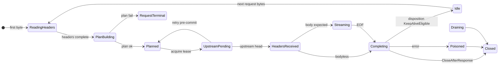
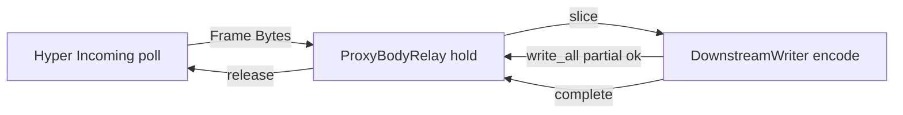
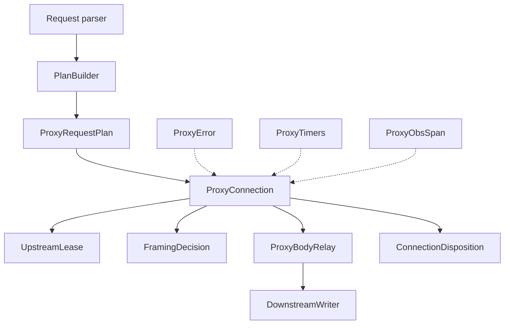
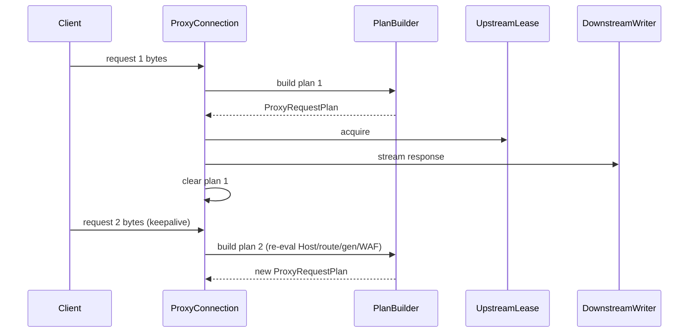
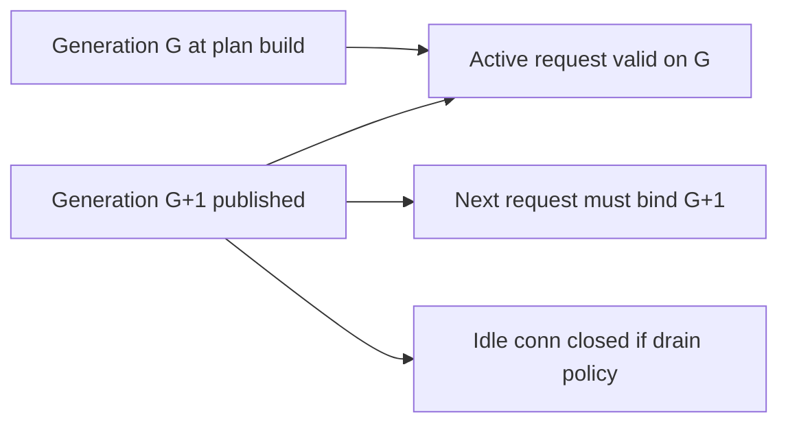
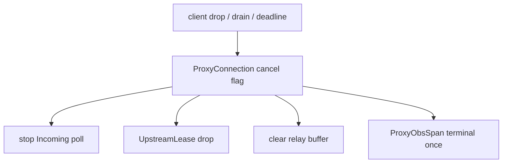
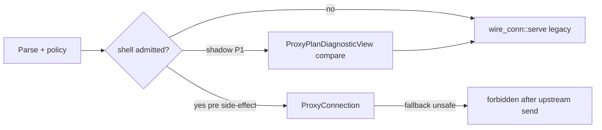

# V044 — Proxy execution data plane contracts & IR (PXDP-P0)

```text
STATUS = COMPLETE
CASE = P0-A
WIP = V044_PROXY_EXECUTION_DATA_PLANE_CONTRACTS_IR
PHASE = PXDP-P0
MODE = READ_ONLY_CONTRACTS_AND_INTERMEDIATE_REPRESENTATION_DESIGN
PARENT_WIP = V044_PROXY_EXECUTION_DATA_PLANE_ARCHITECTURE_DESIGN
PARENT_CASE = PXDP-B
PRODUCT_MUTATION = NO
PROTOTYPE = NO
PUBLIC_BENCHMARK_CLAIMS = FORBIDDEN

SOURCE_HEAD = ade997a362e60d1dc6eafc984da454930600845a
SOURCE_TREE = 4ae6ffc7528d0881be23fcac246c345dcb9a1606
SOURCE_BINARY_SHA256 = e28c0abe18587f2d911d492be64cbec42372383e011417a6c578be52da5ba459
```

**Governance index:** [`../governance/v044-proxy-execution-data-plane-contracts-ir.md`](../governance/v044-proxy-execution-data-plane-contracts-ir.md)

**Parent design (PXDP-B):** [`v044-proxy-execution-data-plane-architecture-design.md`](v044-proxy-execution-data-plane-architecture-design.md)

---

## 0. Binding architecture (PXDP-B recap)

| Decision | Value |
| --- | --- |
| Execution shell | Worker-local `ProxyConnection` (one long-lived connection task) |
| Request plan | **New** immutable `ProxyRequestPlan` per request — never connection-global |
| Upstream | `UpstreamLease` (RAII) + Hyper global pool v1 |
| Body | `ProxyBodyRelay` → `DownstreamWriter` (no `BoxBody` hot path) |
| Hyper | Upstream HTTP/1 protocol engine only |
| Tokio | IO runtime + single connection task |
| Cap067 / static | **Preserve** — unchanged |
| Cap034 productization | **Defer** — contracts must represent A0 and future KA/CL |

### Critical lifetime invariant (mandatory)

```text
ProxyConnection  = CLIENT_CONNECTION_LIFETIME
ProxyRequestPlan = ONE_REQUEST_LIFETIME ONLY

Never: ProxyConnection owns one frozen ProxyRequestPlan for entire keepalive connection.

Always per keepalive request:
  CLIENT_CONNECTION
    → REQUEST_N: BUILD NEW ProxyRequestPlan (Host, route, cluster, generation, WAF, …)
    → execute → complete → clear plan
    → REQUEST_N+1: BUILD NEW ProxyRequestPlan → …
```

---

## 1. Contract inventory & admission filter

Each candidate type passed the filter:

| Contract | Single responsibility | Removes invalid state | Hot path | Verdict |
| --- | --- | --- | --- | --- |
| `ProxyRequestPlan` | YES | YES (immutable admission snapshot) | read-only | **ACCEPT** |
| `ProxyConnection` | YES | YES (connection vs request separation) | YES | **ACCEPT** |
| `ProxyPhase` | YES | YES (legal transitions) | YES | **ACCEPT** |
| `UpstreamLease` | YES | YES (pool RAII) | YES | **ACCEPT** |
| `ProxyBodyRelay` | YES | YES (bounded relay) | YES | **ACCEPT** |
| `DownstreamWriter` | YES | YES (single framing authority) | YES | **ACCEPT** |
| `FramingDecision` | YES | YES (CL/TE/bodyless mutual exclusion) | YES | **ACCEPT** |
| `ConnectionDisposition` | YES | YES (KA/close/poison separate from framing) | YES | **ACCEPT** |
| `ProxyError` | YES | YES (one classification SSOT) | cold | **ACCEPT** |
| `ProxyTimers` | YES | partial | poll-only | **ACCEPT** |
| `RetryPolicyView` | YES | YES (immutable retry budget) | read-only | **ACCEPT** |
| `ProxyObsSpan` | YES | partial | branch-on-sample | **ACCEPT** |
| `ClientIo` | YES | YES (concrete transport, no dyn hot path) | YES | **ACCEPT** |
| `ResponseCommit` | YES | YES (retry boundary) | YES | **ACCEPT** (internal, not public API) |
| `ProxyPlanDiagnosticView` | YES | N/A (shadow only) | NO when disabled | **ACCEPT** (P1 shadow) |

**Rejected (no separate contract):** generic per-frame hook chain; worker-local Hyper pool (future option only); combined `FramingDecision::MustClose|Poisoned` (split to `ConnectionDisposition`).

---

## 2. Contract template records

### 2.1 ProxyRequestPlan

```text
CONTRACT_NAME = ProxyRequestPlan
RESPONSIBILITY = Immutable per-request execution plan: frozen policy outcomes the shell needs without hot-path re-lookup
OWNER = ProxyConnection (active request only, Option while idle)
CREATED_BY = build_proxy_request_plan / PlanBuilder boundary
CREATION_POINT = After parse + routing + WAF (+ rate limit if reachable) per request on connection
DESTROYED_BY = ProxyConnection at request terminal
DESTRUCTION_POINT = Request completion (success, error, cancel) before keepalive re-entry
LIFETIME = REQUEST
MUTABILITY = IMMUTABLE after build
SEND_REQUIRED = YES
SYNC_REQUIRED = NO
WORKER_AFFINITY = admitting worker task (logical)
TASK_AFFINITY = ProxyConnection task
INPUTS = ParsedRequestView, RouteResolution, WafAdmission, GenerationSnapshot, module flags, timeout/retry config, obs seed
OUTPUTS = consumed by shell for upstream send, framing hints, retry, obs
ERRORS = PlanBuildError (never constructs UpstreamLease)
CANCELLATION = plan discarded with request; no async in plan
BACKPRESSURE_ROLE = none (metadata only)
GENERATION_ROLE = binds admitted generation for this request
SECURITY_ROLE = carries WafAdmission terminal outcome; upstream authority fields
OBSERVABILITY_ROLE = RequestId, AttemptId seed, sample bit
ALLOCATION_BUDGET = small bounded owned snapshot (scalars + small strings/IDs)
CLONE_POLICY = Clone only for diagnostic shadow compare — not hot path
ARC_POLICY = Arc only for shared generation snapshot if builder already produced Arc — not default for plan body
LOCK_POLICY = none
INVALID_STATES = reused across requests; mutated after build; upstream connect with WafAdmission != Allowed
INVARIANTS = PLAN_IS_IMMUTABLE_AFTER_BUILD=YES; PLAN_REUSED_ACROSS_REQUESTS=NO; PLAN_REBUILD_ON_KEEPALIVE=YES
```

### 2.2 ProxyConnection

```text
CONTRACT_NAME = ProxyConnection
RESPONSIBILITY = Client connection lifetime: parse loop, one active request, timers, cancellation, poison, lease, relay, disposition
OWNER = single connection async task
CREATED_BY = admission after accept (or shell entry from dispatch)
CREATION_POINT = First byte readable on client socket
DESTROYED_BY = connection task exit
DESTRUCTION_POINT = close/poison/shutdown/drain complete
LIFETIME = CONNECTION
MUTABILITY = INTERNAL_MUTABLE state machine
SEND_REQUIRED = YES (task-owned)
SYNC_REQUIRED = NO
WORKER_AFFINITY = logical worker admission (see §43)
TASK_AFFINITY = exactly one Tokio task owns all fields
INPUTS = ClientIo, server drain/generation signals, PlanBuilder results
OUTPUTS = client bytes, pool returns, terminal obs events
ERRORS = ProxyError → client response / poison / close
CANCELLATION = client disconnect, drain, deadline, shutdown — propagates to lease + relay
BACKPRESSURE_ROLE = OWNER — gates upstream Incoming poll vs downstream writable
GENERATION_ROLE = recheck before each new plan; drain idle on mismatch
SECURITY_ROLE = enforces no second active request; no retry after commit
OBSERVABILITY_ROLE = owns terminal guard (exactly-once)
ALLOCATION_BUDGET = connection parser buffer + one relay window
CLONE_POLICY = FORBIDDEN
ARC_POLICY = none on connection struct itself
LOCK_POLICY = none on hot path (single-task owner)
INVALID_STATES = two active plans; poisoned + keepalive; active lease after terminal
INVARIANTS = MAX_ACTIVE_REQUEST_PLANS_PER_H1_CONNECTION=1; PLAN_CLEARED_AT_REQUEST_COMPLETION=YES; POISON_PREVENTS_NEXT_REQUEST=YES
```

### 2.3 ProxyPhase

```text
CONTRACT_NAME = ProxyPhase
RESPONSIBILITY = Legal connection/request phase for H1 shell state machine
OWNER = ProxyConnection
LIFETIME = CONNECTION (connection sub-state) + REQUEST (request sub-state encoded in same enum or nested)
MUTABILITY = STATE_MACHINE
SEND_REQUIRED = NO (internal)
INVALID_STATES = Streaming without HeadersReceived; retry after commit; reuse after Poisoned
```

### 2.4 UpstreamLease

```text
CONTRACT_NAME = UpstreamLease
RESPONSIBILITY = RAII Hyper pool checkout for one upstream attempt lifecycle
OWNER = ProxyConnection (held during request attempt)
LIFETIME = REQUEST_ATTEMPT (may span connect+headers+body for one attempt)
CREATED_BY = pool checkout after plan admission
DESTRUCTION_POINT = Drop/return at attempt end or connection poison
SEND_REQUIRED = YES (Hyper driver interaction)
INVALID_STATES = returned to pool while poisoned; held after connection Closed
INVARIANTS = NO_UPSTREAM_LEASE_AFTER_TERMINAL_DROP=YES
```

### 2.5 ProxyBodyRelay

```text
CONTRACT_NAME = ProxyBodyRelay
RESPONSIBILITY = Move upstream frames to DownstreamWriter with bounded buffering and backpressure
OWNER = ProxyConnection (sub-state, single-task)
LIFETIME = REQUEST (streaming phase only)
MUTABILITY = INTERNAL_MUTABLE relay window
SEND_REQUIRED = YES
BACKPRESSURE_ROLE = holds bounded bytes; signals upstream pause to ProxyConnection
INVALID_STATES = instantiated for bodyless response; unbounded queue
INVARIANTS = FULL_BODY_COLLECTION=FORBIDDEN; UNBOUNDED_QUEUE=FORBIDDEN
```

### 2.6 DownstreamWriter

```text
CONTRACT_NAME = DownstreamWriter
RESPONSIBILITY = Single downstream framing authority: response head, body encoding, trailers, flush, partial writes, commit tracking
OWNER = ProxyConnection (mut borrow of ClientIo write path)
LIFETIME = REQUEST (from response commit through body complete)
WRITER_KNOWS_FRAMING_DECISION = YES
WRITER_MAY_CHANGE_FRAMING_AFTER_HEADERS = NO
WRITER_TRACKS_COMMIT = YES
WRITER_TRACKS_BODY_BYTES = YES_WHEN_REQUIRED_FOR_LENGTH_INVARIANT
INVALID_STATES = CL+TE; bytes after KnownLength(N) satisfied; chunk terminator twice
```

### 2.7 FramingDecision

```text
CONTRACT_NAME = FramingDecision
RESPONSIBILITY = Downstream on-the-wire body encoding shape only
OWNER = decided at response headers (from upstream meta + plan hints); consumed by DownstreamWriter
VARIANTS = KnownLength(u64) | Chunked | Bodyless | UpgradeTunnel
NOT_VARIANTS = MustClose, Poison (→ ConnectionDisposition)
INVALID = KnownLength+Chunked; Bodyless+body stream; Upgrade+normal body
INVARIANTS = NO_CL_TE_CONFLICT=STRUCTURAL; NO_FRAMING_CHANGE_AFTER_COMMIT=YES
```

### 2.8 ConnectionDisposition

```text
CONTRACT_NAME = ConnectionDisposition
RESPONSIBILITY = Post-response connection terminal policy
OWNER = ProxyConnection (set at response completion from framing + protocol + error state)
VARIANTS = KeepAliveEligible | CloseAfterResponse | Poisoned
CONNECTION_DISPOSITION_OWNER = ProxyConnection (SSOT)
INVALID = KeepAliveEligible when poisoned or ambiguous body completion
```

### 2.9 ProxyError

```text
CONTRACT_NAME = ProxyError
RESPONSIBILITY = Single proxy execution error taxonomy → client status, retry, poison, obs
OWNER = classification at failure site; mapping SSOT in exyonq-mod-proxy (shell module)
ERROR_CLASSIFICATION_SSOT = ProxyError (+ maps from UpstreamAttemptClass, io::Error, WafReject, generation)
```

### 2.10 ProxyTimers

```text
CONTRACT_NAME = ProxyTimers
RESPONSIBILITY = Deadline registry polled by ProxyConnection (no per-timer spawned tasks on hot path)
TIMEOUT_OWNER = ProxyConnection
VARIANTS = client header/body, upstream connect/header/body idle, downstream write, overall request deadline
```

### 2.11 RetryPolicyView

```text
CONTRACT_NAME = RetryPolicyView
RESPONSIBILITY = Immutable Cap021-compatible connect-only retry budget embedded in plan
RETRY_OWNER = ProxyConnection (pre-commit only)
SOURCE = UpstreamTarget.max_connect_retries + method/idempotency rules + overall deadline slice
```

### 2.12 ProxyObsSpan

```text
CONTRACT_NAME = ProxyObsSpan
RESPONSIBILITY = Request/attempt correlation + terminal exactly-once guard
OWNER = ProxyConnection; created from plan obs seed
INVARIANTS = REQUEST_TERMINAL_EVENT_EXACTLY_ONCE=YES; ATTEMPT_TERMINAL_EVENT_EXACTLY_ONCE=YES
```

---

## 3. ProxyRequestPlan — IR field authority

### 3.1 Field ledger

| Field | Canonical source | Why needed | Copy/borrow | Lifetime | Security | Can stale |
| --- | --- | --- | --- | --- | --- | --- |
| `generation: GenerationId` | `ServerState.generation` at plan build | bind config snapshot; lease validity | copy (newtype u64) | REQUEST | YES | NO for active request |
| `request_id: RequestId` | new at plan build | logs/traces/retries | owned | REQUEST | no | NO |
| `attempt_id: AttemptId` | reset per retry attempt | disambiguate retries | owned scalar | ATTEMPT | no | NO |
| `method: Method` | parsed request line | upstream send, retry idempotency | copy enum | REQUEST | YES | NO |
| `protocol: HttpVersion` | parsed | H1 vs future | copy | REQUEST | no | NO |
| `client_authority: ClientAuthority` | Host/:authority header | routing input record | owned small string | REQUEST | YES | NO |
| `route_authority: RouteAuthority` | `resolve_proxy_route` host ranking | Cap034 audit trail | owned | REQUEST | YES | NO |
| `upstream_authority: UpstreamAuthority` | `UpstreamTarget.host` | upstream Host header | borrowed in plan via owned HeaderValue or string | REQUEST | YES | NO |
| `route_id: RouteIdx` | `route_index.match_route_index_with_host` | obs, cache keys | copy | REQUEST | no | NO |
| `cluster_id: ClusterId` | backend resolution | upstream selection | copy u32 | REQUEST | YES | NO |
| `upstream_target: UpstreamTargetSnapshot` | `ProxyRuntime` / compiled slot | connect URI, timeout, retry budget | owned snapshot | REQUEST | YES | NO |
| `path_and_query: PathAndQuery` | parsed target | upstream URI | owned | REQUEST | no | NO |
| `forwarding: ForwardingHeaders` | XFF + upstream host policy | upstream headers | owned small | REQUEST | YES | NO |
| `waf_admission: WafAdmission` | `evaluate_wire_waf` / Hyper WAF hooks | **must be terminal before upstream** | enum | REQUEST | YES | NO |
| `rate_limit: RateLimitAdmission` | rate module if enabled | gate before upstream | enum | REQUEST | YES | NO |
| `module_flags: ModulePlanFlags` | compiled module policy | static dispatch in shell | bitset/small struct | REQUEST | no | NO |
| `retry_policy: RetryPolicyView` | Cap021 + target | pre-commit retries | copy | REQUEST | no | NO |
| `timeout_policy: TimeoutPolicyView` | compiled upstream + server timeouts | ProxyTimers | copy | REQUEST | no | NO |
| `framing_hints: FramingHints` | route/product hints (not Cap034 hardcode) | DownstreamWriter input | copy | REQUEST | no | NO |
| `request_body: RequestBodyPlan` | parser body metadata | future POST; P4=Empty | enum | REQUEST | YES | NO |
| `upgrade_intent: UpgradeIntent` | parser | tunnel handoff | enum | REQUEST | YES | NO |
| `obs: ObsContextSeed` | observability compile | ProxyObsSpan | copy + sample bit | REQUEST | no | NO |
| `keepalive_eligible: bool` | **not frozen across requests** — hint only for parser | next connection disposition input | copy | REQUEST | no | N/A |

**Excluded from plan (implementation only):** parser raw buffer, Hyper `Incoming`, Tokio poll state, socket fds.

### 3.2 Plan validity

```text
plan.is_executable() conceptual requirements:
  - route_id + cluster_id resolved
  - waf_admission == Allowed (or Denied handled without upstream — not executable for upstream path)
  - generation bound
  - upstream_target valid
  - method supported on shell path
  - upgrade_intent compatible with shell phase

Plan-build failure ⇒ PlanBuildError ⇒ never UpstreamLease::acquire
CAN_PLAN_BUILD_FAIL = YES
```

### 3.3 Serialization

```text
IR_SERIALIZATION_REQUIRED = NO
Future shadow: ProxyPlanDiagnosticView (separate, optional, not execution semantics)
```

---

## 4. Generation stability rules

```text
CURRENT_REQUEST_GENERATION_STABILITY_RULE =
  Plan binds GenerationId at build. Active request remains valid on that generation even if
  global generation advances mid-flight — finish or fail under bound snapshot; do not mutate plan.

GENERATION_CHANGED_BEFORE_UPSTREAM_COMMIT =
  If global generation != plan.generation before upstream request bytes sent:
    abort attempt; rebuild plan on next loop iteration OR close if draining.

GENERATION_CHANGED_AFTER_UPSTREAM_COMMIT =
  Active request continues under bound plan.generation; no silent replan mid-attempt.
  Next request MUST rebuild plan against current generation.

GENERATION_CHANGED_DURING_STREAM =
  Same as after commit — stream completes under bound plan; pool lease may be dropped not reused
  if generation invalidates cluster binding (ProxyRuntime cluster_generation mismatch).

NEXT_REQUEST_GENERATION_RECHECK_RULE =
  Before every new ProxyRequestPlan build on keepalive re-entry: generation MUST be read fresh;
  mismatch at idle ⇒ close keepalive socket (do not serve with stale plan).

CONNECTION_DRAIN_RULE =
  On server drain or generation replacement: active request finishes if policy allows;
  idle keepalive closed; new requests rejected; UpstreamLease returned or poisoned per error matrix.
```

**GenerationId newtype:** `GENERATION_IS_NOT_RAW_AMBIGUOUS_U64_IF_NEWTYPE_ADDS_REAL_SAFETY = YES` — prevents accidental mix with attempt counters / route indices.

---

## 5. State machines

### 5.1 Design choice

```text
STATE_REPRESENTATION_SELECTED = HYBRID
WHY =
  - Connection/request phases as enum (async ergonomics, clear transitions)
  - ResponseCommit as small internal enum/typestate for retry boundary (compile-time aid in P1)
  - Avoid full typestate explosion across await points
```

### 5.2 Connection states (H1 v1)

```text
CONNECTION_STATES =
  Idle              # keepalive: waiting for next request bytes
  ReadingHeaders    # accumulating request head (+ bounded buffer)
  Draining          # server/generation shutdown — no new requests
  Poisoned          # protocol/policy failure — no reuse
  Closed            # terminal
```

### 5.3 Request states (nested in active request)

```text
REQUEST_STATES =
  PlanBuilding      # sync policy resolution (may fail → terminal reject)
  Planned           # plan held; no upstream yet
  UpstreamPending   # checkout / connect / send request
  HeadersReceived   # upstream response head known; FramingDecision fixed
  Streaming         # ProxyBodyRelay active (or bodyless skip)
  Completing        # flush, chunk end, commit finalize
  RequestTerminal   # plan cleared; connection → Idle or Closed/Poisoned
```

### 5.4 Transitions (summary)



### 5.5 Invalid transitions

```text
INVALID_TRANSITIONS =
  Idle → Streaming
  Poisoned → Idle
  HeadersReceived → UpstreamPending (retry) after ResponseCommit >= HeadersCommitted
  Streaming → Planned
  Two concurrent request states on one H1 connection
  Closed → any non-terminal
```

```text
INVALID_STATE_COUNT = 18 (see §37 ledger)
INVALID_STATE_LEDGER_COMPLETE = YES
```

---

## 6. HTTP/1 pipelining

```text
H1_PIPELINING_SUPPORT = REJECTED (v1)

MAX_IN_FLIGHT_REQUESTS_PER_CLIENT_H1_CONNECTION = 1

Rationale (source truth):
  - Cap034 wire path is one-shot today (`wire_conn::serve` generation check + shutdown)
  - Host/cluster ranking must rerun per request
  - Pipelining would buffer multiple plans or violate MAX_ACTIVE_REQUEST_PLANS=1

NEXT_REQUEST_BUFFER_OWNERSHIP =
  ProxyConnection input buffer (Bytes/rest carry) — NOT ProxyRequestPlan, NOT ProxyBodyRelay
  Bytes already received for request N+1 while completing N ⇒ hold in connection read buffer until
  N completes and buffer ownership transfers to ReadingHeaders for N+1.

NO_CROSS_REQUEST_HEADER_STATE = YES
```

---

## 7. UpstreamLease & pool boundary

### 7.1 Lease contract

```text
LEASE_ACQUIRED_BY = ProxyConnection
LEASE_LIFETIME = REQUEST_ATTEMPT (one checkout per attempt; new lease on retry)

LEASE_RETURN_ON_SUCCESS =
  Return reusable connection to Hyper pool if protocol clean + not poisoned + generation ok

LEASE_DROP_ON_FAILURE =
  Protocol error, body mismatch, poison ⇒ mark poisoned; do not return reusable

LEASE_POISON_RULE =
  Upstream protocol error mid-body, smuggling suspicion, generation invalidation ⇒ poison lease

LEASE_REUSE_RULE =
  Same upstream host HTTP/1 keepalive per Hyper semantics; shell does not retain lease across requests
  in v1 — new checkout per request attempt (Hyper may reuse TCP underneath)

LEASE_GENERATION_RULE =
  If ProxyRuntime.cluster_generation != plan.generation at checkout ⇒ fail closed (no upstream)
```

### 7.2 Pool boundary (P0 — no redesign)

```text
UPSTREAM_POOL = GLOBAL_HYPER_POOL_V1
WORKER_LOCAL_POOL = FUTURE_OPTION=YES; CURRENT_P0=NO

POOL_CHECKOUT_INPUT =
  UpstreamTargetSnapshot.uri_for(path), method, forwarding headers, timeout, plan.generation

POOL_CHECKOUT_OUTPUT =
  UpstreamLease(handle to Hyper connection + driver interaction surface)

POOL_RETURN_CONTRACT =
  RAII Drop returns or poisons; explicit poison flag on protocol failure

POOL_POISON_CONTRACT =
  Poisoned lease never returned as reusable; aligns with Hyper connection close
```

---

## 8. Body relay & ownership

```text
PROGRESSIVE_STREAMING = YES
FULL_BODY_COLLECTION = FORBIDDEN (HARD)
BOUNDED_MEMORY = YES
BODY_ORDER_PRESERVED = YES
TRAILER_SEMANTICS_DEFINED = YES (forward if product requires; Hyper Incoming source)
UNKNOWN_LENGTH_SUPPORTED = YES (Chunked framing)
KNOWN_LENGTH_SUPPORTED = YES
BODYLESS_SUPPORTED = YES
PARTIAL_FAILURE_DEFINED = YES ⇒ poison
CANCELLATION_DEFINED = YES ⇒ drop lease, stop poll

IS_BYTES_MOVED = YES where possible (Frame into write buffer / write_all)
IS_BYTES_CLONED = ONLY_WHEN_REQUIRED (chunk hex prefix stack buffer — bounded)
PAYLOAD_COPY_REQUIRED = 0–1 bounded target (PERFORMANCE_BUDGET not HARD)

WHO_OWNS_FRAME_BEFORE_WRITE = ProxyBodyRelay
WHO_OWNS_FRAME_DURING_PENDING_WRITE = DownstreamWriter (partial write buffer)
WHEN_FRAME_IS_RELEASED = after full chunk/frame bytes acknowledged written
CAN_NEXT_UPSTREAM_FRAME_BE_POLLED_WHILE_CURRENT_WRITE_PENDING = NO (backpressure)

BODYLESS_CREATES_RELAY = NO

REQUEST_BODY_RELAY_SYMMETRIC_WITH_RESPONSE_RELAY = PARTIAL
  (client upload WAF gate + upstream backpressure differ; same bounded relay pattern)
```

### 8.1 Body frame lifecycle diagram



---

## 9. Backpressure

```text
BACKPRESSURE_OWNER = ProxyConnection

UPSTREAM_MUST_NOT_BE_POLLED_UNBOUNDEDLY_AHEAD_OF_DOWNSTREAM = YES (HARD)
UNBOUNDED_QUEUE = FORBIDDEN (HARD)
FULL_BODY_BUFFER = FORBIDDEN (HARD)

RELAY_HIGH_WATERMARK = semantic: do not poll Incoming if relay buffered bytes >= policy high mark
RELAY_LOW_WATERMARK = resume upstream poll when buffered <= low mark AND downstream writable

UPSTREAM_POLL_ALLOWED_WHEN =
  downstream writable OR relay below high watermark AND not write pending

DOWNSTREAM_WRITE_PENDING_BEHAVIOR = pause upstream poll; retain frame ownership in writer partial buf

SLOW_CLIENT_RULE = stop reading upstream; bounded relay only

SLOW_UPSTREAM_RULE = pause client response writes only via relay — do not buffer entire body

CANCELLATION_RULE = drop relay buffer; cancel upstream body; poison if bytes committed inconsistently
```

---

## 10. Framing vs connection policy

**Decision:** split enums (removes more invalid states than combined enum).

| Concern | SSOT | Values |
| --- | --- | --- |
| On-wire body shape | `FramingDecision` | `KnownLength(n)`, `Chunked`, `Bodyless`, `UpgradeTunnel` |
| Socket after response | `ConnectionDisposition` | `KeepAliveEligible`, `CloseAfterResponse`, `Poisoned` |

```text
FRAMING_SSOT = FramingDecision + DownstreamWriter
CONNECTION_DISPOSITION_SSOT = ProxyConnection at Completing → Idle/Closed/Poisoned

CAP034 legacy A0 = Chunked downstream + CloseAfterResponse (maps cleanly)
Future KA+CL = KnownLength + KeepAliveEligible (no benchmark branch in shell)
```

### 10.1 Response commit

```text
ResponseCommit states:
  NotCommitted
  HeadersCommitted
  BodyCommitted
  Complete

RETRY_ALLOWED_BEFORE = NotCommitted (upstream connect/send only — Cap021)
RETRY_FORBIDDEN_AFTER = HeadersCommitted

CLIENT_CONNECTION_POISONED_AFTER =
  downstream write fail after HeadersCommitted; body length mismatch; upstream error after body bytes to client

UPSTREAM_REUSE_ALLOWED_AFTER =
  successful Complete with clean protocol AND ConnectionDisposition != Poisoned
```

### 10.2 Known length & chunked rules

```text
KNOWN_LENGTH_MISMATCH_RULE =
  BODY_BYTES_WRITTEN <= N at all times; at EOF BODY_BYTES_WRITTEN == N else BodyLengthMismatch + poison + no keepalive

CHUNK_TERMINATION_RULE =
  DownstreamWriter emits final `0\r\n\r\n` exactly once; FINAL_CHUNK_EXACTLY_ONCE=YES

PARTIAL_WRITE_OWNER = DownstreamWriter
NO_FRAME_RELEASE_BEFORE_FULL_WRITE = YES
```

---

## 11. ProxyError taxonomy & SSOT

**One classification authority:** `ProxyError` in shell layer maps all sources.

| Class | Maps from (current product) | Before commit status | After commit action | Retryable | Client reuse | Upstream reuse | Obs class |
| --- | --- | --- | --- | --- | --- | --- | --- |
| `ClientProtocol` | bad request line, smuggling | 400 | poison | NO | NO | release | client_error |
| `ClientDisconnected` | read/write EOF | — | abort | NO | NO | cancel | client_cancel |
| `PolicyRejected` | WAF/rate deny | 403/429 | close | NO | NO | N/A | policy |
| `RoutingFailure` | no route/cluster | 404/503 | close | NO | NO | N/A | routing |
| `UpstreamConnect` | `UpstreamAttemptClass::ConnectFailed` | 502/503 | retry pre-commit | YES* | YES if not committed | release | upstream |
| `UpstreamTimeout` | `TimedOut`, timer expiry | 504 | poison if streaming | NO** | NO if committed | release | timeout |
| `UpstreamProtocol` | Hyper non-connect error | 502 | poison | NO | NO | poison | upstream |
| `UpstreamBody` | frame error | 502 | poison | NO | NO | poison | upstream |
| `DownstreamWrite` | client write fail | — | poison | NO | NO | cancel | client |
| `BodyLengthMismatch` | CL invariant break | 502 | poison | NO | NO | poison | protocol |
| `GenerationInvalidated` | generation/cluster bind fail | 503/close | close idle | NO | NO | drop | control |
| `Cancelled` | drain/shutdown/deadline | — | abort | NO | NO | cancel | cancel |
| `InternalInvariant` | shell bug | 500 | poison | NO | NO | poison | internal |

\*Cap021 connect-only, bounded by `RetryPolicyView`  
\*\*pre-commit timeout may retry if class proven connect-only

Existing `UpstreamAttemptClass` remains upstream attempt oracle — **mapped into** `ProxyError`, not parallel taxonomy.

---

## 12. Retry & timeout & cancellation

### 12.1 Retry

```text
RETRY_OWNER = ProxyConnection
RETRY_BUDGET_SOURCE = ProxyRequestPlan.retry_policy (RetryPolicyView)
RETRY_AFTER_RESPONSE_COMMIT = NO (HARD)
RETRY_AFTER_PARTIAL_BODY = NO (HARD)
RETRY_CREATES_NEW_UPSTREAM_LEASE = YES
RETRY_REUSES_SAME_REQUEST_PLAN = YES only if generation/policy still valid

Generation change between attempts:
  If plan.generation != current generation before retry ⇒ NO retry; rebuild plan or close connection.
  Do not retry under stale generation snapshot.
```

**RetryPolicyView fields:** `max_connect_retries: u8`, `retryable_classes: ConnectFailed only`, `method_idempotent: GET/HEAD wire`, `per_attempt_timeout`, `overall_deadline`.

### 12.2 Timeout ownership

| Timer | Start | Reset | End | Expiry error | Poison |
| --- | --- | --- | --- | --- | --- |
| client header | first byte | per request | headers complete | ClientProtocol/Timeout | rarely |
| client body | headers done | — | body consumed | ClientDisconnected | if partial upstream |
| upstream connect | UpstreamPending | per attempt | connected | UpstreamConnect/Timeout | no |
| upstream header | request sent | per attempt | headers in | UpstreamTimeout | pre-commit retry maybe |
| upstream body idle | first body byte | on data | body EOF | UpstreamTimeout | poison if streaming |
| downstream write | each write | — | ack | DownstreamWrite | poison |
| overall deadline | plan start | — | terminal | Cancelled/Timeout | depends |

### 12.3 Cancellation

```text
CANCELLATION_OWNER = ProxyConnection

NO_ORPHAN_PROXY_TASK = YES
NO_ORPHAN_UPSTREAM_BODY = YES
NO_LEAKED_POOL_LEASE = YES (RAII)
NO_LEAKED_RELAY_BUFFER = YES
OBS_COMPLETION_EXACTLY_ONCE = YES
```

---

## 13. WAF, routing, hop-by-hop

### 13.1 WAF admission

```text
WAF_ADMISSION_RULE =
  ProxyRequestPlan.waf_admission must be terminal Allowed before UpstreamPending.
  UPSTREAM_CONNECT_BEFORE_REQUIRED_WAF_ALLOW = FORBIDDEN (HARD)

Representation (stronger than bool):
  WafAdmission::Allowed
  WafAdmission::Denied { reject: WafRejectSnapshot }
  WafAdmission::BodyGatePending { .. }  # future POST — shell stays Planned until cleared

Canonical evaluator (unchanged): core/server/wire_dispatch::evaluate_wire_waf + core/waf.rs hooks
Shell consumes outcome only.
```

### 13.2 Routing

```text
ROUTING_SSOT = core/server/wire_dispatch::resolve_proxy_route + ServerState.route_index
Plan stores frozen RouteIdx, ClusterId, RouteAuthority, UpstreamTargetSnapshot
No routing algorithm in exyonq-mod-proxy shell
```

### 13.3 Host / authority

```text
CLIENT_AUTHORITY = Host/:authority from client request (ClientAuthority)
ROUTE_AUTHORITY = host key used for route_index.match_route_index_with_host (Cap034)
UPSTREAM_AUTHORITY = UpstreamTarget.host HeaderValue (UpstreamAuthority)
Conversion owner = PlanBuilder (strip_port rules mirror strip_host_port in wire_dispatch)
```

### 13.4 Hop-by-hop

```text
HOP_BY_HOP_SSOT = module-api/src/hop_by_hop.rs (strip_hop_by_hop_headers, Connection tokens)

Request normalization owner = PlanBuilder / upstream request builder (before send)
Response normalization owner = DownstreamWriter + upstream adapter (strip before client)

Wire Cap034 encoder currently skips Connection/TE/CL on copy — must stay consistent with SSOT
```

---

## 14. Module hooks (inventory)

| Hook | Current owner | Before shell | Inside shell | After shell | Per request | Per frame | Plan flag |
| --- | --- | --- | --- | --- | --- | --- | --- |
| `might_use_proxy_wire` | mod-proxy | YES | — | — | conn | no | admission |
| `plan_wire_decision` | core/kernel | YES | — | — | conn | no | — |
| `resolve_proxy_route` | core | YES (in plan build) | — | — | req | no | frozen in plan |
| `evaluate_wire_waf` | core | YES (in plan build) | — | — | req | no | waf_admission |
| `serve_proxy_wire` / shell entry | dispatch | YES | replaces with ProxyConnection | — | conn | no | — |
| `forward_get_for_wire` | mod-proxy | — | YES (attempt) | — | req | no | — |
| `strip_hop_by_hop` | module-api | plan/upstream | response write | — | req | no | — |
| cache policy | mod-proxy | plan flag | optional path | — | req | no | module_flags |
| compression | modules | plan flag | DEFER P4 | — | req | no | module_flags |
| rate limit | modules | plan if enabled | — | — | req | no | rate_limit |
| access log | observability | — | terminal | — | req | no | obs |

**Target:** NO_GENERIC_PER_FRAME_DYNAMIC_HOOK_CHAIN unless product requires (SSE flush policy is writer config, not hook chain).

---

## 15. Security invariant ledger

| ID | Invariant | Enforced by |
| --- | --- | --- |
| SEC-01 | NO_REQUEST_SMUGGLING | parser + plan build + request_headers_safe | CONTRACT + EXISTING |
| SEC-02 | NO_RESPONSE_SMUGGLING | FramingDecision + DownstreamWriter | CONTRACT |
| SEC-03 | NO_CL_TE_CONFLICT | type exclusion + parser gate | CONTRACT + EXISTING |
| SEC-04 | NO_CROSS_REQUEST_CONTAMINATION | 1 plan/request, buffer ownership | CONTRACT |
| SEC-05 | NO_FROZEN_HOST_CLUSTER | PLAN_REBUILD_ON_KEEPALIVE | CONTRACT (HARD) |
| SEC-06 | NO_WAF_BYPASS | WafAdmission gate | CONTRACT + EXISTING |
| SEC-07 | NO_RETRY_AFTER_COMMIT | ResponseCommit | CONTRACT |
| SEC-08 | NO_REUSE_AFTER_POISON | ConnectionDisposition | CONTRACT |
| SEC-09 | NO_UNBOUNDED_BODY_BUFFER | ProxyBodyRelay | CONTRACT |
| SEC-10 | NO_STALE_GENERATION_NEW_REQUEST | generation recheck | CONTRACT |
| SEC-11 | NO_HEADER_INJECTION | HeaderValue to_str gates | EXISTING + WRITER |
| SEC-12 | NO_HOP_BY_HOP_LEAK | hop_by_hop SSOT | EXISTING |
| SEC-13 | NO_POOL_LEASE_REUSE_AFTER_PROTOCOL_ERROR | UpstreamLease poison | CONTRACT |
| SEC-14 | NO_DUPLICATE_SIDE_EFFECT_RETRY | Cap021 + commit boundary | CONTRACT + EXISTING |

```text
SECURITY_INVARIANT_COUNT = 14
SECURITY_INVARIANT_LEDGER_COMPLETE = YES
```

---

## 16. Invalid-state ledger (selected)

| Invalid combination | Prevention |
| --- | --- |
| Poisoned + KeepAliveEligible | ConnectionDisposition mutual exclusion |
| HeadersCommitted + Retry | ResponseCommit gate |
| KnownLength + Chunked | FramingDecision enum |
| Bodyless + active ProxyBodyRelay | request state machine |
| Stale generation + new request without replan | generation recheck at Idle→ReadingHeaders |
| WafDenied + UpstreamLease held | state order Planned→Upstream only if Allowed |
| Poisoned lease + pool return reusable | UpstreamLease Drop contract |
| Closed + active relay | connection terminal first |
| Two active plans H1 | MAX_ACTIVE=1 |
| UpgradeTunnel + body relay | FramingDecision routes to tunnel sub-state |
| Plan reused on keepalive | builder mandatory per request |
| Full body buffer for streaming | relay forbidden |
| Dyn WireStream on P4 hot path | ClientIo enum |
| Retry after generation change under stale plan | retry abort + replan |

---

## 17. Worker-local semantics & I/O

```text
WORKER_LOCAL_SEMANTICS =
  A) Logical ownership: connection task admitted from worker accept path; all shell state is
     task-local single-owner. NOT B) OS-thread pinning.

OS_THREAD_AFFINITY_REQUIRED = NO
OS_THREAD_AFFINITY = NOT_GUARANTEED (Tokio work-stealing may migrate task across threads)

CONNECTION_TASK_AFFINITY = TASK_LOCAL_SINGLE_OWNER

CLIENT_IO_REPRESENTATION = enum ClientIo { Plain(TcpStream), Tls(TlsStream) }  # future TLS
WHY = P4 plain TCP without Box<dyn WireStream>; extensible for P5 TLS

READ_WRITE_SPLIT_POLICY = UNSPLIT_CONNECTION_IO
CLIENT_IO_OWNER = ProxyConnection
DOWNSTREAM_WRITER_ACCESS = &mut ClientIo via ProxyConnection (no split-half Arc)

SAFE_RUST_OWNERSHIP_FEASIBLE = YES
SELF_REFERENTIAL_UNSAFE_REQUIRED = NO preferred (single task; no self-referential futures across fields)
```

---

## 18. Identity types

| Type | Purpose | Newtype? |
| --- | --- | --- |
| `ConnectionId` | connection logs | YES (process-wide counter) |
| `RequestId` | per-request obs | YES |
| `AttemptId` | retry correlation | YES (u8 sufficient) |
| `GenerationId` | config snapshot | YES (wrap u64) |
| `RouteIdx` | route table index | YES (usize) |
| `ClusterId` | u32 newtype | YES |

Do not use ConnectionId as RequestId.

---

## 19. Drop policy

| Type | Drop MAY | Drop MUST NOT |
| --- | --- | --- |
| `UpstreamLease` | mark poison; sync cancel signal | await pool |
| `ProxyBodyRelay` | release buffers | emit terminal obs |
| `ProxyObsSpan` | emit terminal if not yet (sync counter) | duplicate terminal on normal path |
| `ProxyConnection` | close socket sync where needed | hidden retry; surprise response |

```text
DROP_POLICY_COMPLETE = YES
Use explicit terminal completion in normal path; Drop only as fail-safe leak guard.
```

---

## 20. Allocation & stage budgets

### HARD_CONTRACTS

- No unbounded body buffer
- No retry after HeadersCommitted
- No upstream before WafAdmission::Allowed
- No keepalive after poison
- No second active H1 request
- No duplicate external side effect on shadow mode

### PERFORMANCE_BUDGETS (not correctness)

```text
TARGET_BOX_ALLOCATIONS_HOT_PATH = 0
TARGET_STAGE_COUNT = 8
TARGET_TASK_BOUNDARY_BUDGET = <=2
TARGET_CHANNEL_BOUNDARY_BUDGET = <=1
BODY_FRAME_ALLOCATIONS target <=1
BYTES_CLONES target O(1) small responses
PLAN_ALLOCATIONS small bounded constant
```

---

## 21. Arc & lock policy

| Arc site | Why shared | Clones/req | Verdict |
| --- | --- | --- | --- |
| `UpstreamTarget.path_uris` | immutable map | 0 on hot path if snapshot in plan | OK in plan snapshot |
| `ProxyRuntime` | process pinned | once per connection | OK cold |
| Body `Bytes` | refcount move | minimize | prefer move |
| `ProxyRequestPlan` | — | do not Arc on hot path | borrow/move |

```text
NO_GLOBAL_LOCK_IN_PROXY_BODY_HOT_PATH = YES (HARD)
Any lock: ProxyRuntime cluster lookup — cold at plan build only in target shell (not per frame)
```

---

## 22. Send / Sync

```text
ProxyRequestPlan_SEND = YES   ProxyRequestPlan_SYNC = NO
ProxyConnection_SEND = YES    ProxyConnection_SYNC = NO
ProxyBodyRelay_SEND = YES   ProxyBodyRelay_SYNC = NO
```

Single-task ownership — Sync not required on hot path types.

---

## 23. Async cancellation safety (await boundaries)

| Await | Cancellation safe | Notes |
| --- | --- | --- |
| pool checkout | REQUIRES_STATE | lease partial ⇒ drop |
| upstream send | REQUIRES_STATE | attempt counter |
| headers read | REQUIRES_STATE | retry if pre-commit |
| body frame | REQUIRES_STATE | poison if committed |
| downstream write | REQUIRES_STATE | partial buf owner |
| flush | REQUIRES_STATE | |
| timer poll | YES | |

---

## 24. IR boundaries & crate placement

### IR_SEMANTIC_FIELDS

Plan fields §3.1; FramingDecision; ConnectionDisposition; WafAdmission; ProxyError; RetryPolicyView; TimeoutPolicyView; ModulePlanFlags; ObsContextSeed.

### IMPLEMENTATION_ONLY_FIELDS

Tokio poll state; Hyper Incoming; parser carry buffer internals; chunk hex stack arrays; Hyper driver handles.

### TYPE → FUTURE_CRATE_OWNER

| Type | Crate | Visibility |
| --- | --- | --- |
| `ProxyRequestPlan`, shell types | `exyonq-mod-proxy` (internal) | PRIVATE_IMPLEMENTATION |
| `UpstreamTarget` snapshot | `exyonq-mod-proxy` | CRATE_INTERNAL |
| `strip_hop_by_hop_headers` | `module-api` | MODULE_API_STABLE |
| `resolve_proxy_route`, WAF | `exyonq-core` | CRATE_INTERNAL |
| Plan builder entry | `exyonq-core` dispatch → mod-proxy | WORKSPACE_INTERNAL |

```text
MODULE_API_CHANGE_REQUIRED = MAYBE (only if stable hook surfaces change — prefer none in P1)
IR_PROTOCOL_COUPLING = LOW_TO_MEDIUM (semantic plan separate from H1 encoding details)
PLAN_TRANSPORT_AGNOSTIC = YES (transport in ClientIo only)
DUPLICATED_POLICY_AUTHORITY = NONE
CONTRACT_OWNERSHIP_CYCLE = NONE
```

---

## 25. Migration, shadow, fallback

```text
ADMISSION_DECISION_POINT =
  After parse + plan_wire_decision equivalent — BEFORE mutating connection into new shell irreversible state

FALLBACK_SAFE_UNTIL =
  Upstream request bytes sent OR ResponseCommit > NotCommitted (conservative: prefer upstream send)

CAN_FALLBACK_AFTER_NEW_SHELL_START =
  NO once UpstreamPending entered with side effect — legacy path only before checkout

PXDP_P1_SHADOW = DECISION_SHADOW_ONLY
NO_DUPLICATE_EXTERNAL_SIDE_EFFECT = YES (HARD)

LEGACY_AND_NEW_PATH_SHARE_POLICY_TRUTH = YES
  Same resolve_proxy_route, evaluate_wire_waf, UpstreamTarget, Cap021 retry classification

ProxyPlanDiagnosticView = read-only optional compare (route, cluster, generation, WAF, timeout, retry, framing hints)
```

### Feature admission (predicates only)

| Feature | Class |
| --- | --- |
| H1 GET/HEAD wire | SHELL_NATIVE (target) |
| known-length response | SHELL_NATIVE |
| chunked response | SHELL_NATIVE |
| keepalive | SHELL_NATIVE (phase 4 rollout) |
| request body POST | SHELL_NATIVE future |
| SSE | SHELL_NATIVE (flush policy) |
| WebSocket | LEGACY_FALLBACK v1 → tunnel sub-state target |
| CONNECT | LEGACY_FALLBACK |
| trailers | SHELL_NATIVE when product requires |
| compression | LEGACY_FALLBACK / module |
| H2/H3 | FUTURE (plan semantic reuse) |
| TLS client | SHELL_NATIVE via ClientIo::Tls |

---

## 26. Upgrade / tunnel

```text
UPGRADE_PRECONDITIONS = UpgradeIntent detected; WAF allowed; shell exits normal framing
UPGRADE_CONNECTION_OWNER = ProxyConnection TunnelSubState (v1: LEGACY_FALLBACK to hyper websocket path)
UPGRADE_DISPOSITION = ConnectionDisposition::CloseAfterResponse or handoff to raw tunnel
NORMAL_FRAMING_AFTER_UPGRADE = FORBIDDEN
```

---

## 27. Memory lifetime ledger

| Object | Lifetime | Owner | Max/conn | Hot |
| --- | --- | --- | --- | --- |
| ProxyConnection | CONNECTION | task | 1 | yes |
| ProxyRequestPlan | REQUEST | connection | 1 active | read |
| UpstreamLease | ATTEMPT | connection | 1 | yes |
| ProxyBodyRelay | STREAMING | connection | 1 | yes |
| DownstreamWriter | REQUEST | connection | 1 | yes |
| Parser buffer | CONNECTION | connection | 1 | yes |
| Relay window bytes | STREAMING | relay | bounded | yes |
| ProxyObsSpan | REQUEST | connection | 1 | cold |
| ProxyTimers | CONNECTION | connection | 1 | poll |

---

## 28. SSOT map

| Concern | Canonical owner | IR field/interface |
| --- | --- | --- |
| routing | `wire_dispatch::resolve_proxy_route` | route_id, cluster_id, route_authority |
| cluster | ServerState snapshot | cluster_id, upstream_target |
| WAF | `evaluate_wire_waf` / `core/waf` | waf_admission |
| rate limit | rate module | rate_limit |
| generation | ServerState | generation |
| modules | compiled flags | module_flags |
| observability | obs compile + Cap061 | obs seed, ProxyObsSpan |
| framing | FramingDecision | framing_hints + writer |
| connection disposition | ProxyConnection | ConnectionDisposition |
| timeouts | compiled policy | timeout_policy, ProxyTimers |
| retry | Cap021 + target | retry_policy |
| errors | ProxyError | single map |
| hop-by-hop | module-api hop_by_hop | strip at builders |
| request parsing | core/server/io | ParsedRequestView |
| upstream pool | Hyper client | UpstreamLease |

---

## 29. Commit / poison matrix (summary)

| Failure | Before headers | After headers | Mid body | Client reuse | Upstream reuse | Retry | Status |
| --- | --- | --- | --- | --- | --- | --- | --- |
| UpstreamConnect | 502/503 | — | — | yes | release | YES pre-commit | 502 |
| UpstreamTimeout pre-commit | 504 | — | — | yes | release | maybe | 504 |
| UpstreamTimeout streaming | — | — | poison | no | poison | NO | 504 |
| UpstreamProtocol | 502 | poison | poison | no | poison | NO | 502 |
| ClientDisconnected | abort | poison | poison | no | cancel | NO | — |
| DownstreamWrite | — | poison | poison | no | cancel | NO | — |
| BodyLengthMismatch | — | — | poison | no | poison | NO | 502 |
| GenerationInvalidated idle | close | — | — | no | drop | NO | 503 |
| WAF deny | reject | — | — | no | N/A | NO | 403/429 |
| Cancelled/drain | abort | abort | poison | no | cancel | NO | — |

---

## 30. Diagrams

### 30.1 Contract dependency graph



### 30.2 Keepalive request lifetime



### 30.3 Generation lifetime



### 30.4 Cancellation propagation



### 30.5 Legacy ↔ new migration boundary



---

## 31. Conceptual Rust shapes (non-compiling IR)

```rust
// IR only — NOT product code

struct GenerationId(u64);
struct RequestId(u64);
struct AttemptId(u8);
struct ConnectionId(u64);

struct ProxyRequestPlan { /* §3.1 */ }

enum WafAdmission { Allowed, Denied { /* snapshot */ }, BodyGatePending { /* future */ } }

enum FramingDecision { KnownLength(u64), Chunked, Bodyless, UpgradeTunnel }

enum ConnectionDisposition { KeepAliveEligible, CloseAfterResponse, Poisoned }

enum ResponseCommit { NotCommitted, HeadersCommitted, BodyCommitted, Complete }

enum ProxyPhase { /* connection + request §5 */ }

struct ProxyConnection {
    client: ClientIo,
    phase: ProxyPhase,
    active_plan: Option<ProxyRequestPlan>,
    commit: ResponseCommit,
    disposition: ConnectionDisposition,
    // lease, relay, writer, timers, obs — owned sub-states
}

struct UpstreamLease { /* RAII */ }

struct ProxyBodyRelay { /* bounded */ }

struct DownstreamWriter<'a> { /* borrows client write path */ }

enum ClientIo { Plain(/* TcpStream */), Tls(/* future */) }

enum ProxyError { /* §11 */ }

struct RetryPolicyView { max_connect_retries: u8, /* ... */ }

struct ProxyObsSpan { terminal: bool, /* ... */ }
```

---

## 32. ADR-021 design discipline

```text
DESIGN_PATTERN_REVIEW = COMPLETE
NO_NEW_PATTERN_ALTERNATIVE = EVALUATED
  - Full typestate connection: rejected (async ergonomics)
  - Combined framing/disposition enum: rejected (invalid states remain)
  - Worker OS-thread pool: rejected (not evidenced; conflicts with Tokio)
  - Global worker-local Hyper pool P0: rejected (use global pool v1)
PATTERN_SELECTED = Hybrid enum state machine + split framing/disposition + RAII lease + single-task ownership
```

---

## 33. P0 terminal gate

```text
PLAN_SEMANTICS_COMPLETE = YES
PLAN_HAS_NO_EXECUTION_SIDE_EFFECT = YES
PLAN_COMPARABLE_TO_LEGACY_DECISION = YES (via ProxyPlanDiagnosticView)
REQUEST_LIFETIME_CORRECT = YES
SECURITY_POLICY_PRESERVED = YES

NEXT_DESIGN_OR_PRODUCT_WIP_PROPOSAL = V044_PROXY_EXECUTION_DATA_PLANE_SHADOW_PLAN
NEXT_PHASE = PXDP-P1 (NOT STARTED — owner review required)
PXDP_P1_IMPLEMENTATION_AUTHORIZED = NO
```

---

## 34. Related documents

- [v044-proxy-execution-data-plane-architecture-design.md](v044-proxy-execution-data-plane-architecture-design.md)
- [../governance/v044-proxy-execution-data-plane-contracts-ir.md](../governance/v044-proxy-execution-data-plane-contracts-ir.md)
- [../governance/v044-data-plane-architecture-strategic-review.md](../governance/v044-data-plane-architecture-strategic-review.md)
- [../governance/v044-cap034-proxy-framing-keepalive-contract-review.md](../governance/v044-cap034-proxy-framing-keepalive-contract-review.md)

```text
NOTION_UPDATE_REQUIRED = YES
DOCS_RECONCILED = YES
PUSH = NO
```
